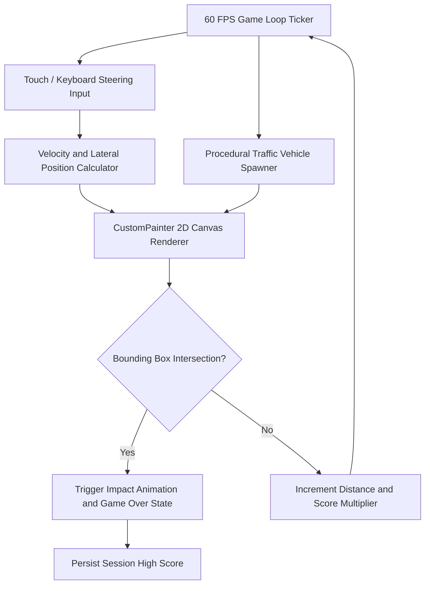

# SPNXA Race Z

<div align="center">

[](https://flutter.dev)
[](https://dart.dev)
[](https://flutter.dev)
[](LICENSE)

</div>

A fast-paced 2D arcade car racing game built with Flutter's CustomPainter canvas engine. Features dynamic track scrolling, lane-changing physics, collision detection, and high-score progression.

---

## Game Architecture & Physics Loop



---

## Features

- **60 FPS Hardware-Accelerated Canvas**: Real-time 2D drawing pipeline utilizing Flutter's `CustomPainter`.
- **Dynamic Traffic Obstacles**: Randomly generated traffic cars with varying speeds across multiple roadway lanes.
- **Progressive Difficulty**: Speed acceleration scaling as the distance travelled increases.
- **Responsive Controls**: Supports both touch swipe gestures for mobile and keyboard arrow keys for web/desktop.
- **Local High Score Tracking**: Saves personal best records locally across sessions.

---

## Controls

| Platform | Steering Left | Steering Right |
| :--- | :--- | :--- |
| **Mobile / Touch** | Tap / Drag Left Screen Half | Tap / Drag Right Screen Half |
| **Desktop / Web** | Left Arrow Key (`<-`) or `A` | Right Arrow Key (`->`) or `D` |

---

## Getting Started

1. Clone the repository:
   ```bash
   git clone https://github.com/Midhun-M-git/spnxa-race-z.git
   cd spnxa-race-z
   ```

2. Install dependencies:
   ```bash
   flutter pub get
   ```

3. Launch the game:
   ```bash
   flutter run
   ```

---

## License

This project is licensed under the MIT License. See the [LICENSE](LICENSE) file for details.
